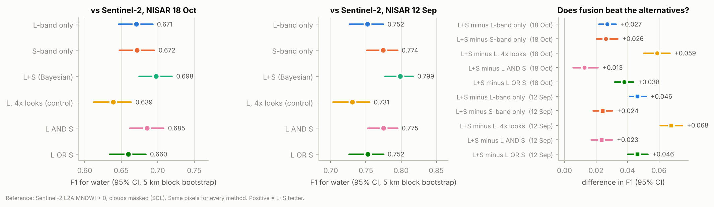
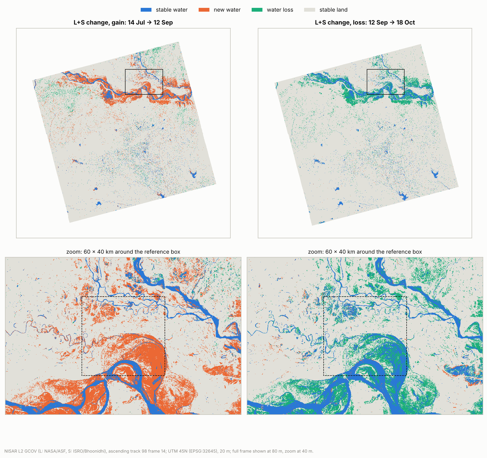

## 1. Question and answer in brief

We mapped surface water over the full NISAR frame around Bihar’s Ganga floodplain (ascending track 98, frame 14; about 250 × 250 km centred on 25.5° N, 86.5° E) on four dates of the 2026 monsoon, and its change between dates, three ways: **L-band only, S-band only and L+S combined**, using only NISAR L2 GCOV data. One algorithm, one set of training pixels and one post-processing chain are used for all three; only the input features change.

**Answer: yes, measurably.** Against Sentinel-2 on every clear pixel (36,400 km² on 18 Oct; 21,900 km² on 13 Sep, 5.4 h after the 12 Sep peak pass), the Bayesian L+S map is the most accurate of the six maps on both dates: F1 = 0.698 [0.674, 0.719] and 0.799 [0.777, 0.817], against 0.671 and 0.752 for L-band only and 0.672 and 0.774 for S-band only. The gains, +0.027 / +0.046 over L and +0.026 / +0.024 over S, have 95% block-bootstrap confidence intervals that exclude zero (McNemar p ≤ 6 × 10⁻⁴), and they are not an effect of more data: L-band averaged to about four times the looks scores 0.639 and 0.731. Between the first joint low-water date (14 Jul) and the peak (12 Sep), 3,774 km² of new water appeared, 80% of it on cropland and 79% within 1 m of the nearest drainage; by 18 Oct, 3,273 km² had receded.

## 2. Data

| | L-band (NASA/ASF) | S-band (ISRO/Bhoonidhi) |
|---|---|---|
| Product | L2 GCOV, PROVISIONAL (calibrated) | L2 GCOV, PROVISIONAL (12 Sep: urgent-response only) |
| Mode, pols used | 40+5 MHz, HH/HV, frequency A, 10 m | 37 MHz, HH/HV, 10 m |
| Dates (UTC; ascending 23:38 = 05:08 IST next day) | 20 Jun, 14 Jul, 12 Sep, 18 Oct 2026 | 14 Jul, 12 Sep, 18 Oct 2026 |
| Nominal looks per 20 m pixel | about 19 | about 64 |

- Joint L+S acquisitions (same orbit, same time) on 14 Jul, 12 Sep and 18 Oct. **No S-band GCOV exists before 14 Jul 2026** (Bhoonidhi search, Nov 2025 – Nov 2026), so 20 Jun (the earliest calibrated L-band date) is L-only, and 14 Jul — when the previews show water still near its seasonal low — is the joint low-water date.
- Exact granule IDs: `data/inventory/nisar_L_gcov_inventory.csv`, `data/inventory/nisar_S_gcov_inventory.csv`, and the tags of every output GeoTIFF.
- Supporting layers (not SAR inputs to the classifier): Copernicus GLO-30 HAND and DEM/slope (hill-shadow masking), ESA WorldCover 2021 (strata), JRC Global Surface Water 1984–2021 (persistent water).
- Reference: Sentinel-2 L2A (Element 84 Earth Search), MNDWI = (B03 − B11)/(B03 + B11) > 0 at 20 m, clouds, cirrus and shadows masked with SCL and dilated by 60 m. 18 Oct: 24 tiles, same UTC day as the NISAR pass (05:01 vs 23:38 UTC); 13 Sep: 29 tiles, about 5.4 h after the 12 Sep peak pass, but cloudy.

## 3. Method

**Preprocessing (`scripts/gcov_to_cog.py`).** Diagonal covariance terms (γ⁰, linear) of frequency A are block-averaged to a common 20 m grid (UTM 45N, EPSG:32645) in linear power. Samples the GCOV mask marks invalid (0) or outside the swath (255) are dropped before averaging. S-band 20 m blocks fall exactly on the L-band 20 m lattice; L–S co-registration on the same pass is 0.00 ± 0.05 px (phase correlation in 10 km windows). Values are stored at the L-band product’s own 16-bit mantissa precision (≤ 0.00003 dB). The analysis domain on a joint date is the set of pixels valid in **both** bands, so every comparison uses identical pixels.

**Classifier (`scripts/water_maps.py`), identical for every feature set.**
1. Split-based Kittler–Illingworth thresholding (Martinis et al. 2015; Chini et al. 2017) of HH dB per band: 5 km tiles whose histograms are clearly two-peaked (Ashman D ≥ 2, both classes ≥ 10%, dark-class mean < −14 dB); one threshold from the pooled tiles.
2. **Common training pixels**: water = dark in every band (HH < t − 1.5 dB) with HAND < 10 m and slope < 5°; land = bright in every band (HH > t + 1.5 dB). The same pixels train L, S and L+S.
3. Class-conditional models in the feature space: water = one Gaussian, land = three-component Gaussian mixture (cropland, trees, built-up …). Prior P(water) by EM over the domain; posterior P(water | x) per pixel (a Bayesian likelihood fusion when the features are [L_HH, L_HV, S_HH, S_HV]).
4. Post-processing: P = 0 where HAND > 15 m or slope > 10° (hill shadow on the Jharkhand plateau); water = P ≥ 0.5; water objects < 10 pixels (0.4 ha) removed. 0.2 < P < 0.8 is reported as the uncertain zone.

Feature sets: **L** = [L_HH, L_HV]; **S** = [S_HH, S_HV]; **L+S** = all four. References: naive **AND**/**OR** of the L and S maps, and the **equal-information control L4x** = L averaged over 2 × 2 blocks in linear power (40 m, about 4× the looks — L+S has about 4.4× the looks of L alone).

**Change (`scripts/change_maps.py`).** Post-classification comparison of two dates on pixels mapped on both: stable water, new water (gain), water loss, stable land, with per-pixel confidence P(gain) = P₂(1 − P₁). New water outside JRC persistent water (occurrence ≥ 75%) is reported as *potential temporary surface inundation*, by WorldCover class and HAND.

**Validation (`scripts/validate.py`).** Wall-to-wall comparison against the Sentinel-2 reference on every clear pixel of the common domain: confusion matrix, precision, recall, F1, IoU, overall accuracy. 95% confidence intervals for F1 and for differences in F1 come from a spatial block bootstrap (5.12 km blocks, 1000 resamples), so spatial autocorrelation does not shrink them; McNemar tests (Foody 2004) on a systematic 500 m subsample; error-adjusted water area (Olofsson et al. 2014) with the reference pixels as the sample.

## 4. Results

### 4.1 Accuracy against Sentinel-2 (`docs/results/validation_*.json`)

Reference pixels: 18 Oct, Sentinel-2 the same UTC day, 36,426 km² clear, 5.2% water; 12 Sep, Sentinel-2 on 13 Sep, 21,941 km² clear, 10.0% water. Areas are over the 57,600 km² common L/S domain.

| Date | Map | F1 [95% CI] | Precision | Recall | IoU | Mapped km² | Error-adjusted km² [95% CI] |
|---|---|---|---|---|---|---|---|
| 18 Oct | L only | 0.671 [0.646, 0.693] | 0.646 | 0.698 | 0.504 | 2,759 | 2,692 [2,550, 2,831] |
| | S only | 0.672 [0.647, 0.695] | 0.701 | 0.645 | 0.506 | 2,374 | 2,730 [2,582, 2,884] |
| | **L+S** | **0.698 [0.674, 0.719]** | 0.709 | 0.688 | 0.536 | 2,464 | 2,686 [2,551, 2,817] |
| | L 4× looks | 0.639 [0.612, 0.664] | 0.580 | 0.712 | 0.469 | 3,147 | 2,692 [2,546, 2,835] |
| | L AND S | 0.685 [0.662, 0.708] | 0.789 | 0.606 | 0.521 | 1,921 | 2,699 [2,562, 2,848] |
| | L OR S | 0.660 [0.634, 0.683] | 0.598 | 0.737 | 0.492 | 3,212 | 2,713 [2,567, 2,856] |
| 12 Sep | L only | 0.752 [0.726, 0.775] | 0.703 | 0.809 | 0.603 | 6,773 | 5,890 [5,565, 6,207] |
| | S only | 0.774 [0.751, 0.795] | 0.872 | 0.697 | 0.632 | 4,964 | 6,121 [5,868, 6,370] |
| | **L+S** | **0.799 [0.777, 0.817]** | 0.826 | 0.773 | 0.665 | 5,630 | 5,990 [5,747, 6,229] |
| | L 4× looks | 0.731 [0.703, 0.755] | 0.675 | 0.797 | 0.576 | 6,860 | 5,838 [5,503, 6,174] |
| | L AND S | 0.775 [0.753, 0.795] | 0.908 | 0.676 | 0.633 | 4,517 | 6,021 [5,784, 6,261] |
| | L OR S | 0.752 [0.726, 0.775] | 0.688 | 0.830 | 0.603 | 7,220 | 5,973 [5,640, 6,294] |

Differences in F1 (95% block-bootstrap CI; McNemar p on the 500 m subsample):

| | 18 Oct | 12 Sep |
|---|---|---|
| L+S − L | +0.027 [+0.022, +0.033], p = 4 × 10⁻⁴⁹ | +0.046 [+0.041, +0.052], p = 1 × 10⁻¹⁴⁶ |
| L+S − S | +0.026 [+0.020, +0.034], p = 3 × 10⁻⁹ | +0.024 [+0.018, +0.030], p = 6 × 10⁻⁴ |
| L+S − L 4× looks (equal-information control) | +0.059 [+0.050, +0.067] | +0.068 [+0.061, +0.075] |
| L+S − AND | +0.013 [+0.006, +0.021] | +0.023 [+0.017, +0.030] (accuracy equal, p = 0.81) |
| L+S − OR | +0.038 [+0.032, +0.044] | +0.046 [+0.040, +0.053] |
| S − L | +0.001 [−0.011, +0.011] | +0.022 [+0.014, +0.031] |

- **Fusion wins on both dates**, against each band alone, against the naive AND/OR combinations and against the equal-information control. L-band with about 4× the looks (40 m) is *worse* than L at 20 m: the loss of resolution outweighs the speckle reduction, so the L+S gain comes from the second frequency, not from more data.
- **The bands fail differently.** L-band has the higher recall and the lower precision (it maps the most water), S-band the reverse; at the peak S-band is the better single band (+0.022), on 18 Oct they tie. The Bayesian fusion keeps most of S’s precision and most of L’s recall.
- **Areas.** Mapped water differs by up to 67% between methods on the same date (18 Oct: 1,921–3,212 km²), but the error-adjusted areas agree: about 2,700 km² on 18 Oct and about 6,000 km² at the peak (cloud-limited sample) over the 57,600 km² common domain. L+S under-maps by about 8% (18 Oct) and 6% (12 Sep).

### 4.2 Where fusion helps (18 Oct; `fig_by_landcover.png`)

| Stratum | Validated km² | Reference water | F1 L | F1 S | F1 L+S |
|---|---|---|---|---|---|
| HAND 0–1 m | 14,545 | 9.8% | 0.802 | 0.768 | 0.807 |
| HAND 1–3 m | 6,251 | 3.1% | 0.625 | 0.643 | **0.666** |
| HAND 3–10 m | 10,418 | 2.1% | 0.291 | 0.355 | 0.344 |
| Cropland | 20,836 | 4.1% | 0.650 | 0.622 | 0.658 |
| Grass | 5,331 | 2.9% | 0.262 | 0.313 | 0.314 |
| Permanent water (WorldCover) | 952 | 75.7% | 0.915 | 0.891 | 0.923 |
| Bare/sparse (sandbars) | 234 | 26.5% | 0.732 | 0.685 | 0.738 |

Fusion helps most just above the active floodplain (HAND 1–3 m, +0.041 over L) and matches or beats the better single band in every land-cover class. Hypotheses from the plan: (1) *dry sandbars dark at L but brighter at S, so fusion cuts false water* — **not supported** as stated: on bare/sparse land S is the weaker band, although fusion is still best; (2) *wind roughens water at S first* — consistent with S’s lower recall at the peak (0.697 vs 0.809), but not separable from vegetation effects with this reference; (3) *flooded vegetation gives an L-band double-bounce signal* — see 4.4. Classes with almost no water (trees, built-up, shrub: 0.3–1.2% water) have F1 below 0.15 for every map; their errors are mostly residual false water in shadows and optical-reference errors.

### 4.3 Change (`docs/results/change_*.json`, `fig_change_LS.png`)

| L+S | Stable water | New water | Water loss | New water outside persistent water |
|---|---|---|---|---|
| 14 Jul → 12 Sep (gain) | 1,775 km² | 3,774 km² | 1,077 km² | 3,758 km² |
| 12 Sep → 18 Oct (loss) | 2,266 km² | 198 km² | 3,273 km² | 195 km² |

{width=55%}

Of the 3,774 km² of new water between 14 Jul and 12 Sep, 3,038 km² (80%) is cropland, 299 km² grass and 332 km² WorldCover permanent water (channel widening); 2,997 km² (79%) lies at HAND < 1 m. Outside JRC persistent water (occurrence ≥ 75%) it is reported as **potential temporary surface inundation**; we do not call it flood without independent evidence. The same pair with L only gives 4,501 km² of new water and with S only 3,616 km² — the band choice changes the answer by 25%, which is why the validated fusion matters. Mapped water over the common domain (L+S): 2,866 km² (14 Jul), 5,630 km² (12 Sep), 2,464 km² (18 Oct).

### 4.4 Polarimetry (14 Sep descending; `fig_polarimetry.png`, `docs/results/polarimetry_20260914.json`)

The PROVISIONAL quad-pol phase error had to be corrected with **e^(+j59°)** for the GCOV HHVV term: open water then sits at −20° and bright double-bounce targets at +167° HH−VV phase (with e^(−j59°), as the known-issues note reads, −138° and +49°). After the correction, 6.1% of the 60 × 40 km window around the reference box shows the double-bounce signature (phase beyond ±120°, HH > −6 dB, HH–VV coherence > 0.3): candidate flooded vegetation, which the optical reference cannot confirm. The S-band compact-pol m-χ decomposition separates the same rivers (odd bounce), vegetation (volume) and settlements (even bounce). Polarimetric features are not yet in the classifier.

## 5. Uncertainty and limitations

- **The reference is imperfect.** Sentinel-2 MNDWI misses water under vegetation and can confuse dark shadows; the 18 Oct image is 18.6 h before the NISAR pass (the water was receding), and on 13 Sep only 31% of the grid is clear. F1 measures agreement with this reference, not truth; differences between maps are the robust part, because every map is scored on the same pixels against the same reference.
- **Spatial autocorrelation** is handled by the 5 km block bootstrap; McNemar uses a 500 m systematic subsample. The error-adjusted areas use the clear reference pixels as the sample, which is not a probability sample of the frame.
- **Training pixels** are where both bands agree; this favours easy pixels, equally for every feature set.
- **S-band:** none before 14 Jul; 12 Sep is urgent-response (geolocation checked: 0.00 px in y, −0.05 px in x against L); ISRO’s “sample shift” flag covers 36% of the ascending S swath and S−L HH differs by about 0.4 dB inside vs. outside it (cause not established).
- **20 Jun fails:** with the same algorithm, L-band alone classifies 46% of the frame as water on 20 Jun (dry, smooth pre-monsoon fields are as dark as water at L-band, and no S-band exists that day). It is excluded; 14 Jul is the low-water baseline.
- **Not done:** incidence-angle banding correction; label-based (Stehman) sampling for cloudy dates; polarimetric features in the classifier. Fixed HAND (15 m) and slope (10°) masks; one frame and track. The descending S-band compact-pol product is offset −0.20 px (4 m) in y from L (used only for polarimetry, not corrected).
- **Frequency B, BETA products and urgent-response L-band products are not used.**

## 6. Reproducibility

Code: `scripts/` (one command per step; `scripts/run_analysis.sh` runs everything after the downloads). Downloads: `scripts/fetch_nisar_l.py` (needs `EARTHDATA_TOKEN`), `scripts/bhoonidhi_s_band.py` (needs Bhoonidhi credentials), `scripts/fetch_ancillary.py` and `scripts/fetch_s2_reference.py` (no login). Results: `docs/results/*.json`; figures: `docs/figures/`. Pinned requirements: `requirements.txt`. Granule IDs: `data/inventory/`.

## References

Chini, M. et al. (2017) A hierarchical split-based approach for parametric thresholding of SAR images: flood inundation as a test case. *IEEE TGRS* 55(12). · Foody, G. M. (2004) Thematic map comparison: evaluating the statistical significance of differences in classification accuracy. *PE&RS* 70(5). · Kittler, J. & Illingworth, J. (1986) Minimum error thresholding. *Pattern Recognition* 19(1). · Martinis, S. et al. (2015) Towards operational near real-time flood detection using a split-based automatic thresholding procedure on high resolution TerraSAR-X data. *NHESS* 9. · Olofsson, P. et al. (2014) Good practices for estimating area and assessing accuracy of land change. *RSE* 148. · Pekel, J.-F. et al. (2016) High-resolution mapping of global surface water and its long-term changes. *Nature* 540. · Shiroma, G. (2026) NISAR L2 GCOV product specification, JPL D-102274 Rev F. · Xu, H. (2006) Modification of normalised difference water index (NDWI) to enhance open water features. *IJRS* 27(14). · ASF NISAR Data User Guide, https://nisar-docs.asf.alaska.edu · ISRO Bhoonidhi, https://bhoonidhi.nrsc.gov.in · ESA WorldCover 2021; Copernicus GLO-30 DEM and GLO-30 HAND; Sentinel-2 L2A via Element 84 Earth Search.
